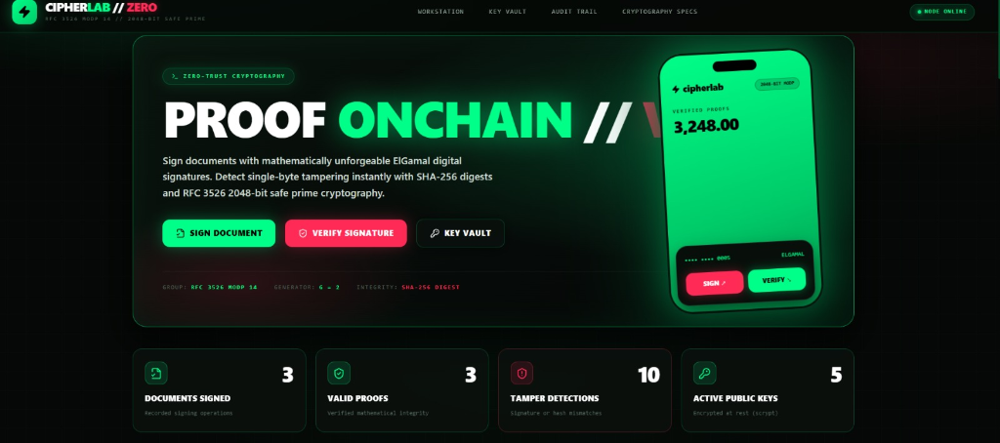
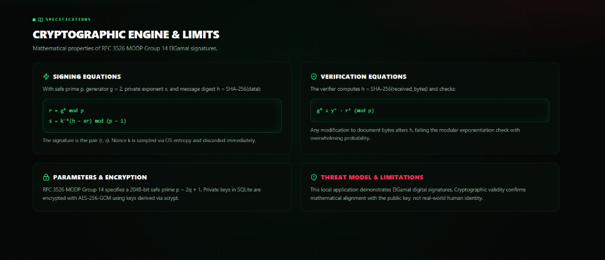
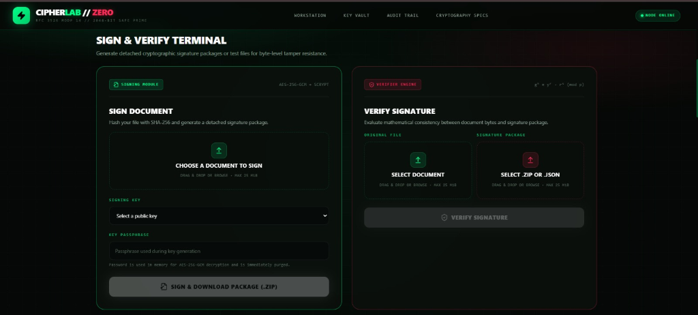
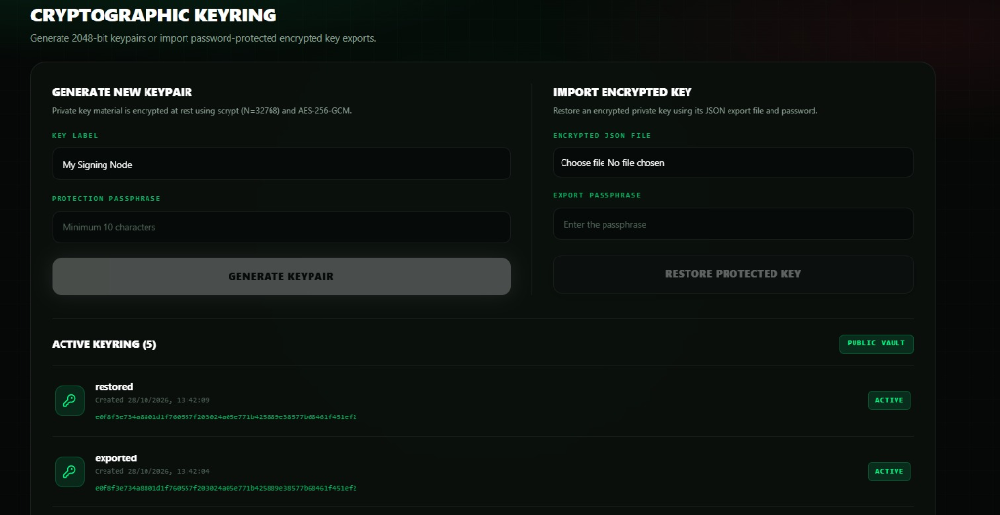

# CIPHERLAB // ZERO
### High-Assurance ElGamal Digital Signature & Cryptographic Integrity System

[](https://datatracker.ietf.org/doc/html/rfc3526)
[](https://en.wikipedia.org/wiki/ElGamal_signature_scheme)
[](https://fastapi.tiangolo.com)
[](https://react.dev)
[-00ff88?style=for-the-badge&logo=pytest)](https://docs.pytest.org)
[](LICENSE)

---

## Executive Overview

**CipherLab // Zero** is a full-stack cryptographic workstation and demonstration platform for digital signatures using the classic **ElGamal Signature Scheme** over standardized finite field parameters (**RFC 3526 MODP Group 14** 2048-bit safe prime, $g = 2$, SHA-256).

<p align="center">
  
</p>

Built with a high-contrast cybersecurity terminal interface (Matrix Green `#00ff88` & Laser Crimson `#ff2a55`), CipherLab bridges theoretical discrete logarithm mathematics and practical software engineering. It provides an interactive **Tamper Detection Lab**, step-by-step **Algorithm Visualizer**, enterprise-style **Key Vault** (with AES-256-GCM + scrypt encrypted storage, rotation, and revocation), an append-only **Audit Ledger**, and a real-time **Benchmark & Performance Suite**.

> **Academic & Experimental Scope:**  
> This system proves mathematical document integrity (verifying that received bytes match the public key and signature equation without corruption). Cryptographic validity establishes consistency with the public key; it does not establish real-world human identity. Run on `localhost` for academic research, defense demonstration, and coursework.

---

## Architectural Highlights

```
CIPHERLAB // ZERO
│
├── Frontend (React 19, TypeScript, Tailwind CSS v4, Vite, Lucide)
│   ├── Unified Single-Page Architecture (Zero Disruptive Navigation Reloads)
│   ├── Cyber Green / Laser Red High-Contrast Telemetry Display
│   ├── 3D Floating Keycard Mockup (Directly Bound to SQLite Records)
│   ├── Workstation Module: Detached Document Signer & Verifier
│   ├── Tamper Detection Lab: Byte-Level Offsets & Avalanche Analysis
│   ├── Algorithm Visualizer: Step-by-Step Educational Simulation (p=467, g=2)
│   ├── Cryptographic Key Vault: Key Generation, Lifecycle, Rotation, Revocation
│   ├── Audit Trail Ledger: Searchable, Filterable Event Stream
│   ├── Performance & Benchmark Lab: Repeatable Empirical Measurements
│   └── Verification Report Generator: Structured JSON Audit Certificates
│
└── Backend (FastAPI, Python 3.12, SQLAlchemy 2.0, Cryptography)
    ├── crypto/elgamal.py: RFC 3526 Group 14 parameters, keygen, signing, verification
    ├── db.py: SQLite schema (PublicKey, Document, Signature, AuditEvent, BenchmarkRecord)
    └── main.py: High-speed asynchronous endpoints, memory-safe ZIP parsing, audit engine
```

---

## Mathematical Specification & Core Equations

<p align="center">
  
</p>

### 1. Finite Field Parameters
CipherLab enforces fixed, cryptographically robust public parameters derived from **RFC 3526 MODP Group 14**:
- **Safe Prime ($p$):** A 2048-bit safe prime $p = 2q + 1$, where $q$ is also prime:
  $$\begin{aligned}
  p = 2^{2048} - 2^{1984} - 1 + 2^{64} \cdot \left( \lfloor 2^{1918} \pi \rfloor + 124476 \right)
  \end{aligned}$$
  ```text
  p = FFFFFFFFFFFFFFFFC90FDAA22168C234C4C6628B80DC1CD129024E088A67CC74...FFFFFFFFFFFFFFFF (2048 bits)
  ```
- **Generator ($g$):** $g = 2$, which generates the cyclic subgroup of quadratic residues in $(\mathbb{Z}/p\mathbb{Z})^*$ of prime order $q = (p - 1) / 2$.
- **Group Order:** $|(\mathbb{Z}/p\mathbb{Z})^*| = p - 1$.
- *Clarification on RFC 3526:* RFC 3526 standardizes Modular Exponential (MODP) groups for Diffie–Hellman key exchange; CipherLab incorporates its published Group 14 safe prime and generator as the public finite field parameters for the classic ElGamal digital signature scheme.

---

### 2. Key Generation
1. Choose private exponent $x$ uniformly at random from $[1, q - 1]$ using OS cryptographically secure entropy (`secrets.randbelow`):
   $$x \in_R \left[1, \frac{p - 1}{2} - 1\right]$$
2. Compute public exponent $y$ via modular exponentiation:
   $$y = g^x \bmod p$$
3. **Public Key:** $(p, g, y)$
4. **Private Key:** $x$ (encrypted at rest using `AES-256-GCM` and a key derived via `scrypt`)
5. **Fingerprint:** Canonical SHA-256 hash of sorted key metadata:
   $$\text{Fingerprint} = \text{SHA-256}\Big(\text{canonical\_json}(p, g, y)\Big)$$

---

### 3. Signature Generation
To sign a document $M$:
1. Compute the cryptographic message digest $h$ over the exact binary payload using SHA-256:
   $$h = \text{int.from\_bytes}\Big(\text{SHA-256}(M), \text{"big"}\Big)$$
2. Generate a fresh, random, secret ephemeral nonce $k \in [2, p - 2]$ such that:
   $$\gcd(k, p - 1) = 1$$
3. Calculate the first signature component $r$:
   $$r = g^k \bmod p \quad (\text{reject if } r \in \{0, 1\})$$
4. Compute the modular multiplicative inverse $k^{-1} \bmod (p - 1)$ using the **Extended Euclidean Algorithm**:
   $$k \cdot k^{-1} \equiv 1 \pmod{p - 1}$$
5. Calculate the second signature component $s$:
   $$s = k^{-1} \cdot (h - x \cdot r) \bmod (p - 1) \quad (\text{reject if } s = 0)$$
6. The detached signature package is the pair $(r, s)$.
7. **Security Guarantee:** The ephemeral nonce $k$ is purged from process memory immediately after computation and is never logged or transmitted.

---

### 4. Signature Verification & Mathematical Proof
To verify a signature $(r, s)$ against document $M$ and public key $(p, g, y)$:
1. **Public Key Validation:**
   $$p == P_{\text{RFC3526}}, \quad g == 2, \quad 1 < y < p, \quad y^{(p-1)/2} \equiv 1 \pmod p$$
2. **Signature Component Range Checks:**
   $$0 < r < p \quad \text{and} \quad \gcd(r, p) == 1$$
   $$0 < s < p - 1$$
3. Compute message digest $h = \text{int}(\text{SHA-256}(M))$.
4. Evaluate the verification equation:
   $$g^h \equiv y^r \cdot r^s \pmod p$$
   If left-hand side equals right-hand side, the signature is mathematically valid.

#### Mathematical Proof of Correctness:
$$\begin{aligned}
y^r \cdot r^s &\equiv (g^x)^r \cdot (g^k)^s \pmod p \\
&\equiv g^{x \cdot r} \cdot g^{k \cdot s} \pmod p \\
&\equiv g^{x \cdot r + k \cdot s} \pmod p
\end{aligned}$$
Since $s = k^{-1}(h - x \cdot r) \bmod (p - 1)$, we have:
$$k \cdot s \equiv h - x \cdot r \pmod{p - 1} \implies x \cdot r + k \cdot s \equiv h \pmod{p - 1}$$
By Fermat's Little Theorem (modular arithmetic in the exponent modulo $p - 1$):
$$g^{x \cdot r + k \cdot s} \equiv g^h \pmod p \quad \blacksquare$$

---

## Detailed Feature Modules

### 1. Dual Workstation (Sign & Verify Terminal)

<p align="center">
  
</p>

- **Document Signing:**
  - Select document through drag-and-drop file uploader (supports up to 25 MiB).
  - Select an active keypair from the Key Vault.
  - Enter the passphrase to temporarily decrypt the private key $x$ in memory using `scrypt` ($N=32768, r=8, p=1$) and `AES-256-GCM`.
  - Automatically packages and downloads `signature-package.zip` containing:
    - `signature.json`: Full machine-readable cryptographic envelope (metadata, digest, public key parameters, signature $(r, s)$, fingerprint, and timestamp).
    - `signature.txt`: Clean human-readable text format for CLI verifiers (`r=...`, `s=...`).
- **Signature Verification:**
  - Ingests the original file alongside the signature package (`.zip` or raw `.json`).
  - Reads archives directly in RAM with zero disk extraction to eliminate directory traversal vulnerabilities.
  - Independently re-computes document SHA-256 digest, checks public key parameters, and checks modular congruence.
  - Cross-references the key fingerprint with the SQLite key registry to warn if the key was subsequently revoked.

---

### 2. Live Tamper Detection Lab
Demonstrates the **SHA-256 avalanche effect** and why digital signatures provide strict byte-level tamper detection:
1. **Interactive Byte Editor:** Specify an exact byte offset (e.g. index 0 or byte 42) and choose a replacement byte value (0–255).
2. **Dual-Hash Comparison:** Displays the original SHA-256 hash vs. the modified document's SHA-256 hash.
3. **Avalanche Visualization:** Modifying even a single bit in the document changes ~50% of the output bits in the SHA-256 digest.
4. **Verification Outcome:**
   - Original file evaluates to: `VALID (100% integrity match)`.
   - Tampered file evaluates to: `REJECTED (0% integrity match)`.
5. **Divergence Reason:** Explains why $g^{h_{\text{tampered}}} \not\equiv y^r \cdot r^s \pmod p$.
6. **Report Export:** Generates an official downloadable `tamper-investigation-report.json`.

---

### 3. Step-by-Step Algorithm Visualizer
Designed for computer science lectures, presentations, and cryptographic audits:
- Runs an isolated educational simulation using small safe-prime parameters ($p = 467, g = 2, q = 466$) to display comprehensible numbers rather than 600-digit hex strings.
- Interactive step cards display:
  - **Step 1:** Key generation ($x = 105, y = 2^{105} \bmod 467 = 444$).
  - **Step 2:** Message hashing ($M \to \text{SHA-256} \to h = 288$).
  - **Step 3:** Ephemeral nonce selection ($k = 211$) and Extended Euclidean modular inverse ($k^{-1} \bmod 466 = 413$).
  - **Step 4:** Component computation ($r = 2^{211} \bmod 467 = 124$, $s = 413 \cdot (288 - 105 \cdot 124) \bmod 466 = 28$).
  - **Step 5:** Verification equation ($2^{288} \equiv 444^{124} \cdot 124^{28} \equiv 272 \pmod{467}$).
  - **Step 6:** Single-character tamper demonstration proving mathematical failure.

---

### 4. Cryptographic Key Vault

<p align="center">
  
</p>

- **Zero-Plaintext Storage:** Private exponents are encrypted at rest using `AES-256-GCM` with 96-bit random nonces and 256-bit keys derived with `scrypt` ($N=2^{15}, r=8, p=1$).
- **Lifecycle Tracking:** Visual indicators for `ACTIVE`, `REVOKED`, and `RETIRED` keys.
- **Key Rotation Workflow:** Retires an existing key and establishes a new 2048-bit keypair in a single atomic transaction.
- **Revocation Protocol:** Revokes compromised keys with an audit reason and disables future signing while preserving verification history.
- **Encrypted Backup & Recovery:** Download and import password-protected JSON key backups (`elgamal-encrypted-private-key.json`).

---

### 5. Append-Only Audit Ledger
- Records all cryptographic events in an immutable SQLite database (`audit_events` table):
  - Event Types: `SIGNING`, `VERIFICATION`, `KEY_GEN`, `KEY_REVOKE`, `KEY_ROTATE`, `KEY_IMPORT`.
  - Stored Metadata: Timestamp, filename, SHA-256 digest, key fingerprint, result code, diagnostic details.
- **Privacy Assurance:** Never logs private keys, passwords, or ephemeral nonces.
- **Search & Filter:** Real-time search across filenames, fingerprints, and digests with instant event-type filters.

---

### 6. Benchmark & Performance Lab
Provides repeatable empirical evaluation across standard payload sizes:
- Evaluates **1 KB**, **100 KB**, and **1 MB** payloads over multiple iterations.
- Real empirical telemetry:
  - **SHA-256 Hashing Duration (ms)**
  - **ElGamal 2048-bit Signing Duration (ms)**
  - **Modular Verification Duration (ms)**
  - **Valid Signature Pass Rate (100%)**
  - **Tamper Detection Accuracy (100%)**
- Automatically records operating system and CPU environment details.

---

## Repository Structure

```text
c:\Users\HP\OneDrive\Documents\ChatGPT\PBA\
├── README.md                      # Comprehensive project documentation & specification
├── .gitignore                     # Git rules (excludes virtualenvs, node_modules, secrets)
├── .env.example                   # Environment configuration template
│
├── backend/                       # Python FastAPI Backend
│   ├── requirements.txt           # Production dependencies
│   ├── app/
│   │   ├── __init__.py            # FastAPI entry point
│   │   ├── db.py                  # SQLAlchemy models & SQLite connection pooling
│   │   ├── main.py                # REST endpoints, CORS, file streaming, audit logic
│   │   └── crypto/
│   │       ├── __init__.py        # Crypto package init
│   │       └── elgamal.py         # RFC 3526 parameters, signing, verifying, visualizer
│   ├── tests/
│   │   ├── test_api.py            # API integration tests, key lifecycle, tamper lab
│   │   └── test_crypto.py         # Cryptographic unit tests & boundary conditions
│   └── data/
│       ├── signatures.db          # Local SQLite database (git-ignored)
│       └── uploads/               # Local secure document vault (git-ignored)
│
└── frontend/                      # React 19 + TypeScript + Vite Frontend
    ├── package.json               # Frontend dependencies & npm scripts
    ├── tsconfig.json              # TypeScript strict configuration
    ├── vite.config.ts             # Vite configuration with Tailwind CSS v4 & Vitest
    ├── index.html                 # Single Page Application HTML entry
    └── src/
        ├── main.tsx               # Application mount point
        ├── App.tsx                # Single-page workstation, labs, and interactive modals
        ├── App.test.tsx           # React Testing Library & Vitest integration tests
        └── style.css              # Cyberpunk green/red design system & custom scrollbars
```

---

## Installation & Local Execution

### Prerequisites
- **Python:** Version 3.11 or 3.12
- **Node.js:** Version 20.x or higher
- **Package Manager:** `npm` or `pnpm`

### 1. Backend Setup
In a terminal:
```powershell
# Navigate to backend directory
cd backend

# Create virtual environment
python -m venv .venv

# Activate virtual environment (Windows PowerShell)
.\.venv\Scripts\Activate.ps1

# Install required dependencies
pip install -r requirements.txt

# Start FastAPI development server
uvicorn app.main:app --host 127.0.0.1 --port 8000 --reload
```
Interactive Swagger API documentation will be available at: <http://127.0.0.1:8000/docs>.

### 2. Frontend Setup
In a second terminal:
```powershell
# Navigate to frontend directory
cd frontend

# Install Node dependencies
npm install

# Start Vite development server
npm run dev
```
Open your browser to: <http://localhost:5173>.

---

## Automated Test Suite

CipherLab includes unit and integration tests across both the Python cryptographic backend and React frontend.

### Running Backend Tests (pytest)
```powershell
cd backend
python -m pytest -v
```
**Test Results (21 / 21 Passed):**
```text
tests/test_api.py::test_health PASSED                                    [  4%]
tests/test_api.py::test_stats_structure PASSED                           [  9%]
tests/test_api.py::test_key_generation_and_no_plaintext_leak PASSED      [ 14%]
tests/test_api.py::test_key_revocation_and_rotation PASSED               [ 19%]
tests/test_api.py::test_sign_verify_and_tamper_roundtrip PASSED          [ 23%]
tests/test_api.py::test_verify_malformed_package PASSED                  [ 28%]
tests/test_api.py::test_protected_key_import_and_wrong_password PASSED   [ 33%]
tests/test_api.py::test_tamper_lab_endpoint PASSED                       [ 38%]
tests/test_api.py::test_algorithm_simulation_endpoint PASSED             [ 42%]
tests/test_api.py::test_benchmark_endpoint PASSED                        [ 47%]
tests/test_api.py::test_audit_trail_endpoint PASSED                      [ 52%]
tests/test_crypto.py::test_generate_consistency PASSED                   [ 57%]
tests/test_crypto.py::test_sign_verify_unchanged_and_changed PASSED      [ 61%]
tests/test_crypto.py::test_wrong_key_fails PASSED                        [ 66%]
tests/test_crypto.py::test_corrupt_components_fail PASSED                [ 71%]
tests/test_crypto.py::test_empty_file_and_fresh_nonces PASSED            [ 76%]
tests/test_crypto.py::test_invalid_key_and_signature_package PASSED      [ 80%]
tests/test_crypto.py::test_fingerprint_stable PASSED                     [ 85%]
tests/test_crypto.py::test_single_byte_tampering PASSED                  [ 90%]
tests/test_crypto.py::test_toy_simulation_math PASSED                    [ 95%]
tests/test_crypto.py::test_extended_gcd_and_inverse PASSED               [100%]
============================== 21 passed in 16.25s ==============================
```

### Running Frontend Tests (vitest)
```powershell
cd frontend
npm test
```
**Test Results (3 / 3 Passed):**
```text
 ✓ src/App.test.tsx (3 tests)
   ✓ shows the dashboard empty state when there is no activity
   ✓ shows a loading state and then the invalid verification result
   ✓ shows a useful API error on verification failure
Test Files  1 passed (1) | Tests  3 passed (3)
```

### Production Build Verification
```powershell
cd frontend
npm run build
```
Compiles with 0 TypeScript errors into `frontend/dist/`.

---

## REST API Reference

| Method | Endpoint | Description |
| :--- | :--- | :--- |
| `GET` | `/api/health` | Returns service status, cryptographic scheme, and parameter metadata |
| `GET` | `/api/stats` | Real-time database metrics (signed documents, valid proofs, tamper events) |
| `GET` | `/api/keys` | Returns active, revoked, and retired public keys with fingerprints |
| `POST` | `/api/keys/generate` | Generates 2048-bit keypair and returns encrypted private key export |
| `POST` | `/api/keys/revoke` | Revokes a compromised key with mandatory audit reason |
| `POST` | `/api/keys/rotate` | Retires current key and generates a new active keypair |
| `POST` | `/api/keys/import` | Validates and restores password-encrypted private key export |
| `POST` | `/api/sign` | Ingests document file & passphrase; returns detached signature package ZIP |
| `POST` | `/api/verify` | Evaluates document & signature package; checks math & key status |
| `POST` | `/api/tamper-lab/run` | Executes controlled single-byte modification and compares hashes |
| `GET` | `/api/algorithm/simulate` | Returns step-by-step arithmetic trace over educational parameters |
| `POST` | `/api/benchmarks/run` | Executes empirical performance tests across 1 KB, 100 KB, and 1 MB files |
| `GET` | `/api/benchmarks/history` | Retrieves historical benchmark test execution records |
| `GET` | `/api/audit-trail` | Returns searchable, filterable audit ledger of cryptographic events |

---

## Security Model & Cryptographic Safeguards

1. **Nonce Freshness:** Ephemeral nonces $k$ are generated using OS CSPRNG (`secrets.randbelow`) and rejected if not coprime to $p - 1$. Reusing a nonce $k$ across two different messages would allow trivial derivation of the private key $x$ via $s_1 - s_2 = k^{-1}(h_1 - h_2) \pmod{p-1}$. CipherLab strictly guarantees nonces are never reused or logged.
2. **Digest Pre-image Resistance:** Signatures are computed over SHA-256 digests rather than raw message integers, preventing existential forgery attacks on textbook ElGamal signatures.
3. **Subgroup Confinement:** Signatures and public keys are validated to reject elements of order $\le 2$ and ensure membership in the quadratic residue subgroup.
4. **Passphrase-Derived Key Storage:** Private keys in SQLite are protected with `scrypt` ($N=32768, r=8, p=1$) and `AES-256-GCM` authenticated encryption. CipherLab never persists or logs plaintext passphrases.

---

## Academic Attribution & License

- **Cryptographic References:**
  - ElGamal, Taher. *"A Public Key Cryptosystem and a Signature Scheme Based on Discrete Logarithms."* IEEE Transactions on Information Theory, 1985.
  - Kivinen, T., Kojo, M. *"More Modular Exponential (MODP) Diffie-Hellman groups for Internet Key Exchange (IKE)."* RFC 3526, 2003.
- **License:** Open-source under the [MIT License](LICENSE).
